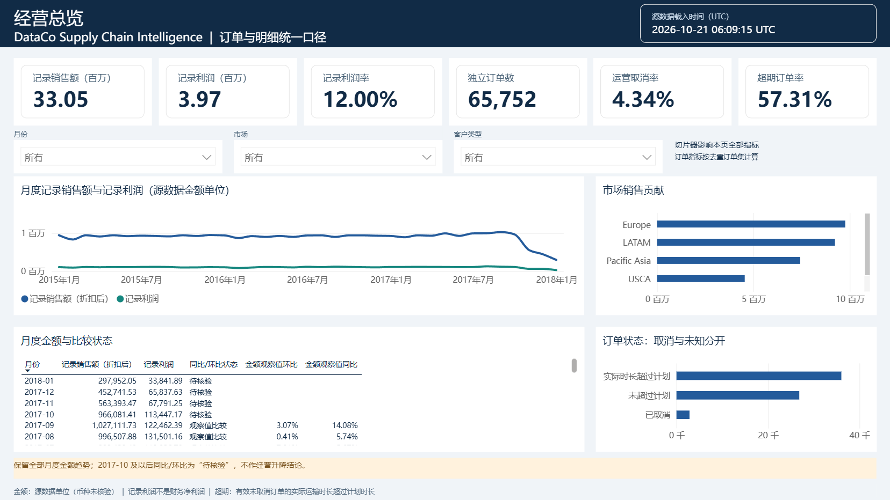

# DataCo Supply Chain Intelligence

使用 Python、SQL 和 Power BI 分析 **180,519 条订单明细、65,752 笔独立订单**，完成数据审计、双粒度建模、统一 KPI、运输时效诊断和四页交互展板。



## 核心结果

| 指标 | 结果 |
|---|---:|
| 折扣后记录销售额 | 33,054,402.38 |
| 记录利润 | 3,966,902.97 |
| 记录利润率 | 12.00% |
| 有效未取消订单 | 62,897 |
| 运输时长超过计划的订单 | 36,048 |
| 超期订单率 | 57.31% |
| 负利润明细比例 | 18.71% |

Standard Class 贡献 41.60% 的超期订单。First Class 的 9,602 笔有效订单全部超过源计划时长，需核验计划规则及字段定义。运输方式的比例与订单规模并列展示，不作因果推断。

金额为源数据单位，币种未核验；记录利润不是财务净利润，超期不是最终签收迟到。2017-10 及以后保留金额趋势，同比/环比列为“待核验”，不输出经营升降结论。

## 项目实现

- 数据治理：主键、订单内属性一致性、金额字段关系和取消状态差异审计；原数据始终只读。
- 分析模型：订单与订单明细双事实表、五个维度、六条单向业务关系；商品筛选通过去重订单集统计运营指标。
- 指标对账：24 项核心指标在 Python/SQL 间独立对账；实际 Desktop 中完成 404 项 DAX 检查，含商品/运输筛选、月度和空样本边界。
- 可视化：46 个测量值，经营总览、时效诊断、商品利润、客户市场四页原生 Power BI 展板；已实际刷新、保存并重开验证。
- 工程：Python 3.12、SQLite、命令行管道、29 项自动化测试、依赖锁文件及输入/产物指纹。

## 查看成果

- [Power BI 源项目（PBIP）](powerbi/DataCoSource/DataCoSupplyChain.pbip)
- [四页截图与实际验收记录](powerbi/ACCEPTANCE.md)
- [中文分析报告（下载后用浏览器打开）](reports/analysis_report.html)
- [业务发现与建议](docs/BUSINESS_CASE.md) · [指标合同](docs/METRIC_CONTRACT.md) · [数据边界](docs/LIMITATIONS.md)

本公开仓库只包含代码、模型/布局定义、聚合结果和截图。原始 CSV、客户/订单行级衍生表及含导入明细的 PBIX 保留本地。PBIP 不内嵌数据，复现时须自行获取源数据并设置 DataFolder 参数。完整发布范围见 [PUBLICATION.md](PUBLICATION.md)。

## 本地复现

1. 从 [Mendeley Data，Version 5](https://data.mendeley.com/datasets/8gx2fvg2k6/5) 获取 DataCoSupplyChainDataset.csv 和 DescriptionDataCoSupplyChain.csv，放入 data/raw。
2. 创建 Python 3.12 环境并安装依赖：

```powershell
python -m venv .venv
.\.venv\Scripts\python.exe -m pip install -r requirements-lock.txt
.\.venv\Scripts\python.exe -m pip install --no-build-isolation --no-deps -e .
.\run_pipeline.ps1
```

3. 打开 PBIP，在 Power BI Desktop 中把 DataFolder 参数设为当前项目 powerbi/data 的绝对路径，应用查询并刷新；需要单文件时另存 PBIX。
4. Desktop 验收可使用 scripts/verify_powerbi_desktop.py；安装与路径说明见 [刷新/重建指南](powerbi/REBUILD.md)。

测试使用合成样本，无需下载原始数据：

```powershell
.\.venv\Scripts\python.exe -m pytest -q --basetemp=.pytest_tmp
```

更换源数据后需重新执行 Python 管道和 Desktop 刷新验收；仓库中的 404 项验收是当前历史快照，不能自动证明新数据也通过。详细说明见 [复现指南](docs/REPRODUCTION.md)。

## 来源与许可

数据：Fabian Constante、Fernando Silva、António Pereira，DataCo SMART SUPPLY CHAIN FOR BIG DATA ANALYSIS，Version 5，DOI 10.17632/8gx2fvg2k6.5。源站许可 CC BY 4.0；本仓库不分发原始数据。

源码改造自 [Mo-210/dataco-supplychain-analytics](https://github.com/Mo-210/dataco-supplychain-analytics)，保留原作者的 [MIT LICENSE](LICENSE)。本项目是非官方派生改造，P1 情景模拟与 P2 预测模型不在本次范围。
