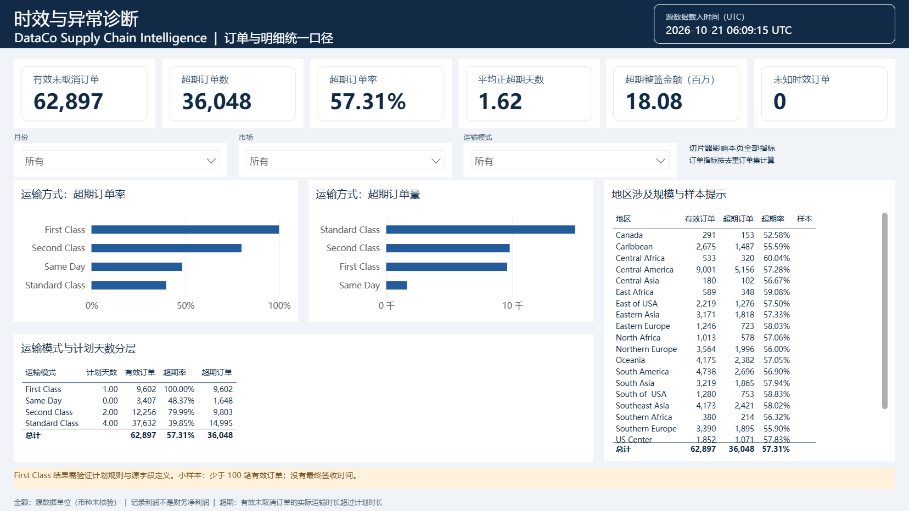
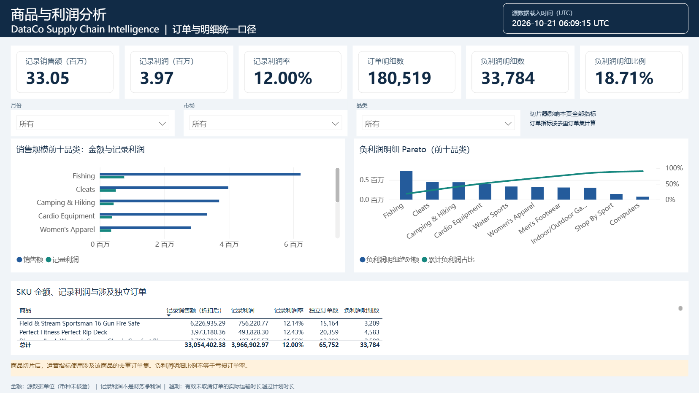
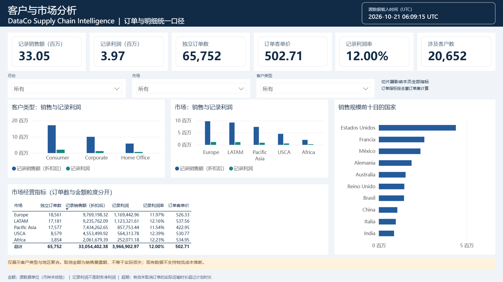

# Power BI 四页实际验收（2026-10-21）

本次已完成原生 Power BI 四页制作、真实数据刷新、指标对账、切片器检查、PBIX 保存及重新打开。正式入口为 DataCoSupplyChain_P0.pbix（含明细，仅本地交付）；对应源项目为 [DataCoSupplyChain.pbip](DataCoSource/DataCoSupplyChain.pbip)。

## 环境与交付

- Microsoft Power BI Desktop 64 位，版本 2.159.883.0；主程序 D:/Apps/Power BI Desktop/bin/PBIDesktop.exe。
- 主程序、报表、源码、作者工具和安装临时目录位于 D 盘。Windows 安装维护缓存及 Desktop 用户配置仍使用系统目录，未擅自移除系统安装缓存。
- 7 张业务分析表：65,752 笔订单、180,519 条明细、5 个维度；另有载入元数据表与 KPI 测量值容器。46 个测量值，4 页共 83 个原生视觉对象（含说明文字）。
- 原始 CSV 未改写；模型不导入姓名、邮件、密码、街道、邮编或经纬度。行级关系键仅本地使用。
- [交付清单与 SHA256](../reports/powerbi/delivery_manifest.json)、[分区实际刷新时间](../reports/powerbi/desktop_refresh_metadata.json)。分区时间保留引擎返回的原值（不附加推测时区），查询采集时间另记 UTC。页面 UTC 显示的是 Python 源数据载入时间，不冒充 Desktop 刷新时间。

## 已执行检查

| 验收项 | 结果 | 证据 |
|---|---|---|
| 原生 PBIR/项目结构与格式属性 | 0 错误、0 警告 | [官方架构校验](../reports/powerbi_schema_validation.json) |
| 全样本业务 KPI | 24/24 通过 | [真实 DAX 对账](../reports/powerbi/desktop_acceptance.json) |
| 运输方式、商品筛选 | 207/207 通过 | 同上；期望值与实测结果分开保存 |
| 月度金额与同比/环比、比较政策、行数和边界 | 通过；合计 404/404 | 同上 |
| 项目自动化测试 | 29/29 通过 | [验证汇总](../reports/verification.json) |
| 可编辑源码与正式 PBIX 的视觉类型、查询绑定 | 83/83 一致 | [源文件与 PBIX 比较](../reports/powerbi/source_pbix_parity.json) |
| PBIX 保存与重新打开 | 通过；重开后 404/404 再次通过 | [重开会话实测输出](../reports/powerbi/desktop_dax_results.json) |
| 四页数据和视觉检查 | 通过；卡片、趋势、表格、Pareto、筛选及中文口径正常 | 下方四页原生截图 |

计数精确一致；金额误差小于 0.0000001 量级，低于合同允许的 0.01；比例与平均天数亦满足合同容差。取消订单单独筛选时不进入有效时效分母，空筛选计数为 0，零分母比例为空值。

切片器实际交互已验证：Accessories 对应 1,780 条明细、1,753 笔独立订单、119,712.55 折扣后销售额；First Class 对应 9,602 笔有效订单、9,602 笔超期订单、100.00% 超期率及 1.00 天平均正超期。清除选择后恢复全样本。交付默认停留经营总览，各页切片器均为“所有”。

| 关键指标 | 实际结果 |
|---|---:|
| 折扣后记录销售额 | 33,054,402.38 |
| 记录利润 | 3,966,902.97 |
| 记录利润率 | 12.00% |
| 全部独立订单 | 65,752 |
| 有效未取消订单 | 62,897 |
| 超期订单 | 36,048 |
| 超期订单率 | 57.31% |
| 运营取消订单 | 2,855 |

## 四页原生画布

经营总览：金额、记录利润、订单、取消率、超期率、全月度趋势和待核验比较状态。

时效与异常诊断：运输方式超期率与超期量并列、计划天数分层、地区规模和小样本提示。

商品与利润分析：前十品类金额/利润、负利润绝对额 Pareto、SKU 金额与独立订单数。表格和品类条形图保留原生滚动、悬停和放大功能。

客户与市场分析：客户类型、市场金额/利润、客单价、独立订单数和目的国家聚合。

## 适用边界

本次验收针对当前源数据快照和本地 Desktop。币种、财务利润组成、最终签收时间及 2017-10 起的数据结构变化原因仍未核验；展板明确显示相应口径。2017-10 及以后保留金额趋势，同比/环比为空并显示“待核验”，不输出经营升降结论。未向 Power BI Service 发布，也未配置云端计划刷新。

以后更新源数据需先重跑 Python 管道，再刷新 Desktop 并重新验收。打开与迁移步骤见 [REBUILD.md](REBUILD.md)。
